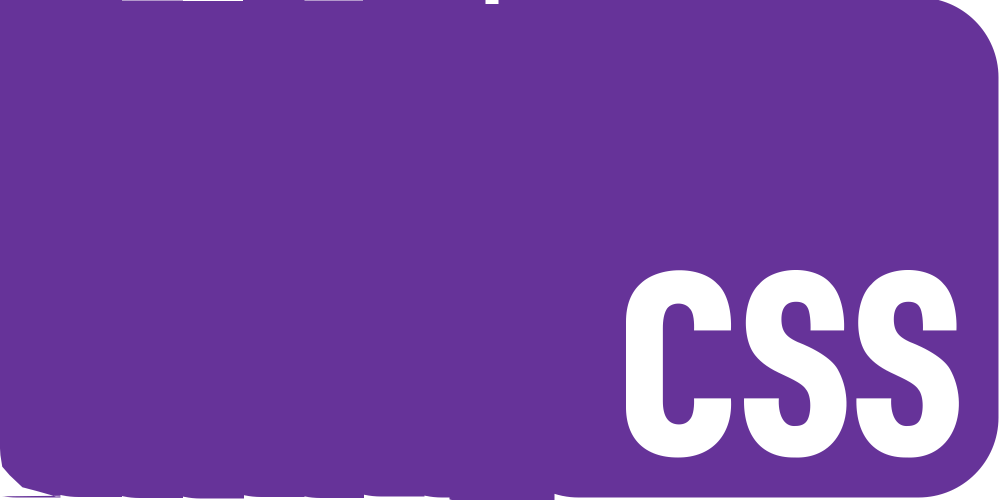
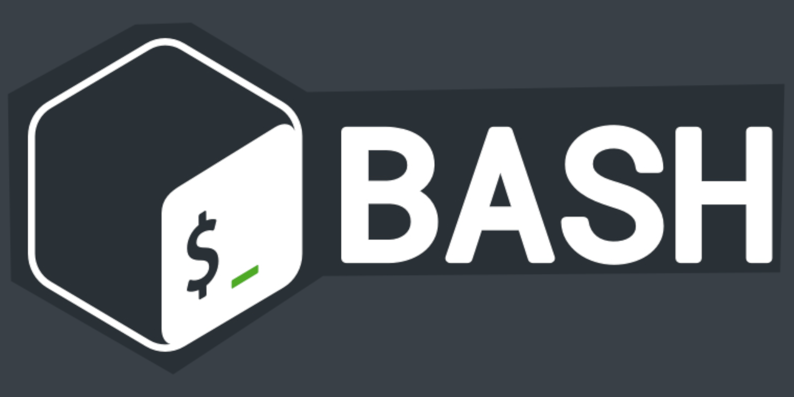
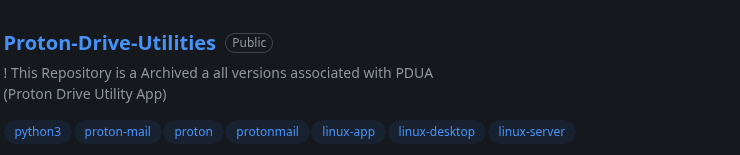
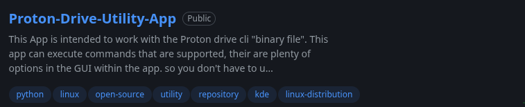
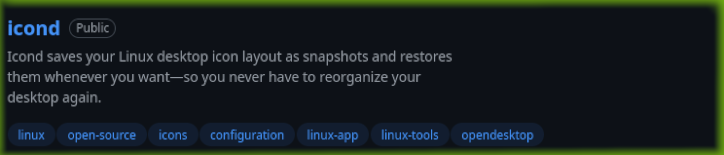
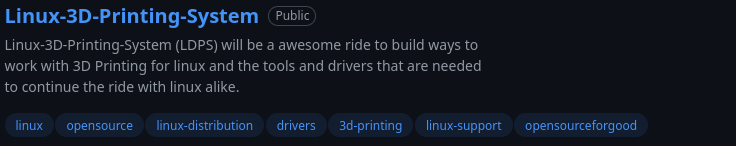
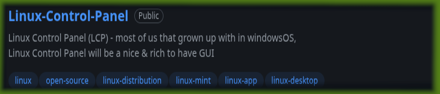
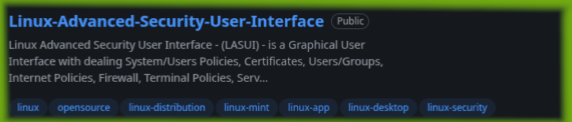
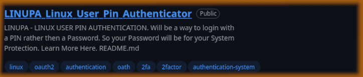
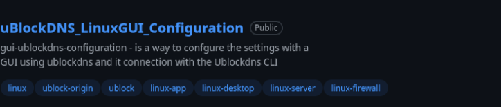

## Hi there 👋
### My name is Scott 🙋

 > Give Ideas or Support on these Products/Services email me @:  

 - My Email
 > <mark>scott.the.developer@email-me.unixinbox.com</mark>

 ### You can find me else where.
 - My GitHub Page - https://github.com/CyberCrime-Stoppers
 - My Codeberg Page - https://codeberg.org/CyberCrime-Stoppers
 - My OpenDesktop Page - https://www.opendesktop.org/u/CyberCrime-Stoppers

 

## The Greed on Technology & the rich demons that does wrong in so many ways.
  - My Legacy and goals are to fight for what matters and is civil.
  
  - The CyberCrime-Stoppers is not what it means. its a Reference: A Public-Awareness on how big-tech in the western side of the world In today's world it seem to be used as a Crime & for Greed. Tech is a tool & suppose to be safe, helpful for everyone!

  - Having the power of owning our shit we pay and own. not for the rich to take, we paid so why should we give up our privacy as a human right, and for them to NOT allow us or in other words make is near impossible to do what we want with our devices and shit we own, we have and can fix what we worked hard for as we wish, also will help limit whats in the landfills.

  - Fighting for what we really want and deserve takes a village for us to protect our legacy and rights as humans, heck we work so damn hard. don't let them take away or think otherwise.  

 
 
  
### A bit about me.

 

<tr>
<td>

</td>
</tr>

###### I been a developer on GNU/Linux since 2017 _

 

> Enjoying developing creating software and hardware that has security mechanisms, also helping people with their tech problems, building new ways on better computing.

 

###### Have been working on projects since 2011 _ 

- 2011 Built a wireless remote car. built light that follows along with the radio. etc.
- 2015 Built a smart room.
- 2017 Developing with Linux and Building mini, server, and LAN - While Working with Different linuxOS Distributions.
- 2021 + built complex servers and projects. also home designs.

 

> I enjoy and successful on making circuits, Building with raw materials to build smart homes from scratch, building alarm system, Built many types of sensors. love building micro-chip that eventualy can be programed starting from a circuit board, then subsidizing into more complex compute logic down to many more layers of added compute logic then eventualy so small that is built into a wafer that can be turned into a micro-chip that the eye can't see.' always making it small.  until the micro-chip is at least 4 to 8 bit if not 128 bit for better compute power for the purpose of being able to be programed.

> Building a circuit into for example micro-controller. we can always make our own processor, building your own architiure can be easy then people make it, but if you have an idea, just have to know a bit of knowlage on how to build circuits also why you made it and how you make it, and all the different circuit into it's own logical sub systems, so that it can be turned into a processor with many lagical compute modules and connections of a bunch different circuit and logical circuits that you built over time for the sake of building a micro-chip it's always possible to build a micro-chip. 

> it's just ticles my fancy. 

 

 

### Taking back our control & enjoying what love doing as consumers.
#### also what would be living if we don't do things we enjoy.

**CyberCrime-Stoppers/CyberCrime-Stoppers** is a ✨ _special_ ✨ place for linux and the future goal for GNU and linux App, Tools, Drivers & Utilities, and working on things that matter for the OpenSource Communities and around the world that needs a clean and usable tools for Linux that we will most likely rely on in near future. with time of needs.

- 🔭 I’m currently working on ... ( icond and LCP ).
<!--- 🌱 I’m currently learning ... ways to bettering linux. --->
- 👯 I’m looking to collaborate on ... Anything Linux Related.
- 🤔 I’m looking for help with ... anything, ideas & what the linux community needs.
<!--- 💬 Ask me about ... --->
- 📫 How to reach me: ... by Email: scott.the.developer@email-me.unixinbox.com
<!--- 😄 Pronouns: ... --->
<!--- ⚡ Fun fact: ... --->

### Follow me on other Platform Servers
	   
	- 📕 My OpenDesktop, HomePage Username - CyberCrime-Stoppers
	
	- 📗 My OpenDesktop, Products
	     
 📕 https://www.opendesktop.org/u/CyberCrime-Stoppers
 
 📗 https://www.opendesktop.org/u/cybercrime-stoppers/products

	
 Proton Drive Utility App, Official .Deb Release. - 🔖 https://www.opendesktop.org/p/2372306
 __________________________________________________________________________________
 
 ## What is currently happening with big Tech vs Open-source Products/Services & its communities.
 __________________________________________________________________________________

 
 
### Always thinking Security & Privacy
- I always develop and think up new ways to improve security mechanisms and enhance the nature of the technology we all share as a society.
- Fighting for the rights and freedom that come with the digital world: let's fight for the right to own our shit.

### Future Goals for GNU/Linux. [Linux has Potential].
- We are realizing globally that Linux offers superior privacy and freedom. Having an operating system we can truly rely on is a benefit for everyone.
  The old society clings to outdated ways of thinking that are no longer relevant. True happiness comes from having no control imposed upon us,
  and we can shift this mindset for the next generation
- the great things that Linux and Open-Source Communities Software Products & Services, is that drawn to anyone that wants to tinker, rebuild, reverse engineer and do what you wish on
software/hardware, that we like to do what we want on.

### Dangers on Megacorps & Big Tech
- Having the ability to do what we want on the technology we paid for was never supposed to be controlled by megacorps or evil corporations that dictate what
  we do on our machines. It’s uncivilized and malicious. Technology should not control people or make them addicted to their devices; rather, it is supposed to serve a purpose. 
  People who use technology should have the freedom to decide how and when to use their devices—and when to disconnect

### I am Building new Hardware
- Not explaining much about the hardware that is currently being developed, but it will help change & rewrite the security of the technology we all use today.
- Will be a great things to come with that piece of tech.
- 
 __________________________________________________________________________________
 
  <strong> The Goals Listed below 👇 </strong>  
  
- [✔️]Building an Operating System - Linux Distribution in mind.
  
   
  
- [✔️] Supporting & Bettering Linux. 
- [✔️] Protecting the Digital Freedom and Rights. 
- [✔️] Protecting the Privacy of our right as human. 
- [✔️] Everyone has the right to have free speech. 
- [✔️] Moving away from Microsoft/Windows into Linux - [as a choice]. 
- [✔️] New Encryption technolgoy for digital world - Quantum Encryption/Cryptographic Technology. 
- [✔️] Developing New hardware and Software - to Harden Security, AI, Quantum Computing, [New Gen DDoS], etc. 
- [✔️] Developing more support for Software and hardware for GNU/Linux. 
- [✔️] Developing more Driver support for newer and hardware that is current not supported.

 
 
  
- This will increase the GNU/Linux market share. The goal has always been Linux, given that it runs 90% of the world's infrastructure, powers the Internet, smart devices, and the IoT (Internet of Things). Without a doubt, we need more options for people around the world regarding software and drivers if we are to properly utilize Linux.

### ALL Repositories on the CyberCrime-Stoppers GitHub Page. 
 __________________________________________________________________________________

		
		🟥 PINK  - Created by C.C.S Total  ( 1 )
		🟩 GREEN - Created by C.C.S Total  ( 4 )
		🟨 YELLOW - Created by C.C.S Total ( 2 )
		🟧 ORANGE - Created by C.C.S Total ( 1 )
		🟦 BLUE - Creayed by C.C.S Total   ( 1 )
		
		Offical Releases & Usable Apps By C.C.S Total ( 1 ) [PDUA]
		Created Linux Apps By C.C.S Grand Total ( 10 )
		
		------------------------------------------------------------
		Human vs AI on Developing my Repos
		
		
		LLM/AI      ( %% )

		[pdua]      (25 %)
		[lcp]       (60 %)
		[l3dps]      (    )
		[lasui]     (    )
		[alf]       (    )
		[linupa]    (    )
		[ubdns]     (    )
		[low]       (    )
		
		
		HUMAN       ( %% )
		
		[pdua]      (75 %)
		[lcp]       (40 %)
		[l3dps]      (    )
		[lasui]     (    )
		[alf]       (    )
		[linupa]    (    )
		[ubdns]     (    )
		[low]       (    )
		
		
		------------------------------------------------------------
		
		Owner Username _ Acronym
			C.C.S = CyberCrime-Stoppers - [The Username & the owner of the GitHub Page]
		
		Apps _ Acronym
			> PDUA = Proton Drive Utility App
			> LCP = Linux Control Panel
			> L3DPS = Linux 3D Printing System
			> LASUI = Linux Advanced Security User Interface
			> ALF = Linux Advanced Firewall
			> LINUPA = Linux User Pin Athenticator	
			> UBDNS = uBlockDNS Configuration GUI
			> LOW = List of Websites
			
		Legend _ What these mean on the products created on this GitHub Page.
			> Apps = [ Needs Attention ]  
			> Tools = [ Needs Attention ] 
			> Drivers = [ Needs Attention ]
			> Services = [ Needs Attention ]
			> Utilities = [ Needs Attention ]
			
		🟥 PINK  - Proton AG Accounts & Services (Apps & Utilities). 
		🟩 GREEN - (Apps, Tools, Drivers & Utilities). 
		🟨 YELLOW - Firewall & Anti-Virus (Apps, Utilities & Services) 
		🟧 ORANGE - Linux User Protection Authentication System - built right into TPM1.2 + TPM2.0 (Systemd Level)
		🟦 BLUE - Servers, Networking, Internet & DNS, (Apps, Tools & Utilities)
__________________________________________________________________________________			

 ### My Personal & Created Repos. (Original).
	
<tr>
 <td>
<!--- 1   --->

<!--- 2   --->

<!--- 3   --->

<!--- 4  --->

<!--- 5  --->

<!--- 6  --->

<!--- 7  --->

<!--- 8  --->

 </td>
</tr>
